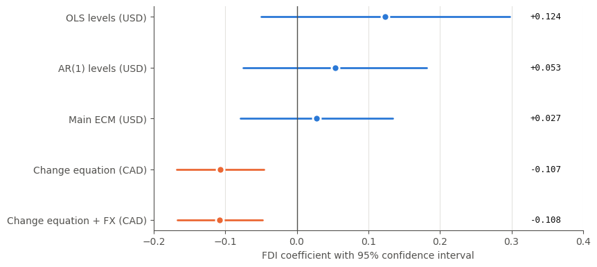

# Does FDI Stimulate Business Investment in Canada? (1981–2018)

Code and archived data for *Foreign Direct Investment and Business Investment in Canada* (Porokmi Sambahamphe, revised 2026).

## Project history and current status

This project began as an undergraduate research paper in 2019. I revisited it in 2026 while preparing writing samples for PhD and research job applications. The revision reconstructs the dataset, moves the analysis from EViews to Python, examines unit roots and cointegration, and reassesses the interpretation of the original levels regression. It is a revision of that earlier project, rather than a wholly new study.

The linked paper is the current revised draft. The original 2019 paper is not currently archived in this repository. The findings are descriptive and sensitive to specification; this project does not identify a causal effect of FDI. See [the revision notes](docs/REVISION_NOTES.md) for the remaining methodological questions and supplementary checks.
📄 **[Read the paper](paper/Sambahamphe_FDI_Canada.pdf)** · 📓 **[Open the notebook](FDI_Canada.ipynb)**



## The question

Foreign direct investment can finance new plants, equipment and technology, but a recorded inflow need not create an equivalent amount of fixed capital: foreign investors may acquire an existing firm or provide financing that substitutes for funds available elsewhere. Whether FDI adds to business investment (crowding in) or displaces it (crowding out) is therefore an empirical question. I examine it for Canada over 1981–2018, revisiting Van Loo (1977), who reported an FDI coefficient of about 1.40, and my own earlier levels regression, which interpreted a positive FDI coefficient as evidence of complementarity.

## What I found

- **No significant FDI association in the main US-dollar models:** OLS 0.124 (p = 0.156), AR(1) 0.053 (p = 0.405) and the error-correction model 0.027 (HAC p = 0.615).
- **The main US-dollar sample supports cointegration between investment and expenditure** (Engle–Granger p = 0.002): about 37% of the previous year's deviation is corrected within a year (error-correction term −0.369, p = 0.019).
- **The sign depends on currency:** Canadian-dollar change equations give a negative association of about −0.107 to −0.108 (p < 0.001), even with an exchange-rate control. Currency conversion behaves as a specification change, not a simple rescaling.
- **No robust evidence of a positive FDI association; the estimates do not establish a causal increase or decrease in investment.** FDI measures financial inflows, which can include acquisitions of existing assets, and the main ECM retains residual serial correlation (Breusch–Godfrey p = 0.001).

## Methods

| Step | Method | Notebook section |
|---|---|---|
| Capacity slack | HP filter (λ = 100) on log real GDP; U = potential − actual | 2 |
| Stationarity | Augmented Dickey–Fuller (levels with trend, differences) | 4 (Table 1) |
| Levels model | OLS, then AR(1) errors via iterative GLSAR | 5 |
| Long-run link | Engle–Granger cointegration of investment and expenditure | 6 |
| Short-run model | Error-correction model, Newey–West (HAC) standard errors | 6 (Table 2) |
| Diagnostics | Breusch–Godfrey serial-correlation test | 7 |
| Robustness | C$ units, 1981–2024 sample with 2020 indicator, FDI × U interaction, first differences ± exchange rate | 8 (Table 3) |

## Data

| Variable | Source |
|---|---|
| Business gross fixed capital formation (I), nominal and real GDP | Statistics Canada, [Table 36-10-0222-01](https://doi.org/10.25318/3610022201-eng) |
| Gross national expenditure (Y) | World Bank WDI, `NE.DAB.TOTL.CD` |
| FDI net inflows | World Bank WDI, `BX.KLT.DINV.CD.WD` |
| Exchange rate (CAD per USD) | World Bank WDI, `PA.NUS.FCRF` |

The processed datasets used in the paper are in [`data/`](data). Values are in billions (US$ and C$ versions of each series).

*Source: Statistics Canada, Table 36-10-0222-01. Reproduced and distributed on an "as is" basis with the permission of Statistics Canada, under the [Statistics Canada Open Licence](https://www.statcan.gc.ca/en/terms-conditions/open-licence). World Bank data used under [CC BY 4.0](https://datacatalog.worldbank.org/public-licenses).*

## Reproduce

1. Open `FDI_Canada.ipynb` in [Google Colab](https://colab.research.google.com) or Jupyter.
2. Keep `REBUILD_DATA = False` to reproduce the paper exactly from `data/`. Set it to `True` to download the latest data instead (source revisions may change results slightly).
3. Run all cells. Figures are saved to `figures/` and tables to `tables/`.

Requirements: `pip install -r requirements.txt`

Supplementary specification checks: `python src/specification_audit.py`. These use the archived CSVs and write separate outputs to `tables/audit/`; they do not overwrite the paper's original tables. Models within each sample/currency comparison use common observations, so their coefficients need not match the paper's 37-observation baseline.

## Repository

```
├── FDI_Canada.ipynb      analysis notebook (run top to bottom)
├── paper/                the paper (PDF)
├── data/                 processed datasets, 1981–2018 and 1981–2024
├── figures/              Figure 1 (data) and Figure 2 (FDI coefficients)
├── tables/               Tables 1–3 as CSV
└── requirements.txt
```

## How this was built: AI disclosure

I used AI (Anthropic's Claude) throughout this project. To be clear about who did what:

- **Author's role (as documented for the initial repository):** the research question and original 2019 paper; specification choices (US$ as the main units and the FDI × U interaction hypothesis); running the notebook models; interpreting the results; and preparing the paper.
- **AI's part:** coaching me through the econometric steps; writing the data-download and HP-filter code, the figure code and the table-export code; providing code skeletons for the models; reviewing drafts of the paper; and reorganizing the final notebook.
- **This repository:** assembling the files and checking that the archived data reproduces every reported result were also done with AI help, using Claude Code.

- **Subsequent revision assistance:** ChatGPT assisted with prose revisions, review of econometric limitations, repository documentation, and supplementary diagnostic code. AI-assisted changes require the author's review; the use of AI does not validate the methods or findings.

