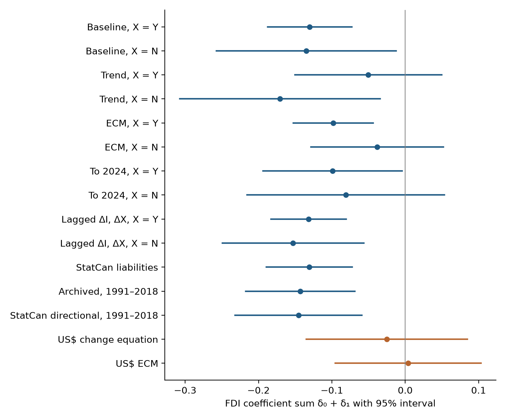

# Does FDI Stimulate Business Investment in Canada? (1981–2018)

Replication code and data for my research on foreign direct investment and business investment in Canada (Porokmi Sambahamphe, 2026). There are two papers:

- 📄 **[Short paper](paper/Sambahamphe_FDI_Canada.pdf)** (revised November 2026), reproduced by 📓 [`FDI_Canada.ipynb`](FDI_Canada.ipynb).
- 📄 **[Extended Working Paper](paper/Sambahamphe_FDI_Canada_Extended_Working_Paper.pdf)** (revised November 2026), with the full set of checks. Code in [`extended/`](extended).



## The question

Foreign direct investment can finance new plants, equipment and technology, but a recorded inflow need not create an equivalent amount of fixed capital: foreign investors may acquire an existing firm or provide financing that substitutes for funds available elsewhere. Whether FDI adds to business investment (crowding in) or displaces it (crowding out) is therefore an empirical question. I examine it for Canada over 1981–2018, revisiting Van Loo (1977), who reported an FDI coefficient of about 1.40, and my own 2019 undergraduate regression, which interpreted a positive FDI coefficient as evidence of complementarity.

## What I found

- **Canadian dollars are the primary unit.** Converting to US dollars at a moving exchange rate adds a revaluation component to every annual change. In 2015, investment fell by about C$15 billion, but its US-dollar value fell by US$62 billion, US$51 billion of which was exchange-rate revaluation.
- **Negative conditional association, mainly with a one-year lag.** In a change equation with current and lagged FDI, the coefficient sum is −0.130 (95% interval −0.188 to −0.073). It is negative in every Canadian-dollar specification examined and robust to Statistics Canada's own FDI series, single-year omissions and extra short-run dynamics.
- **Sensitive to how trends and expenditure are modelled.** With a linear trend and total expenditure as the control, the sum is −0.050 and not significant. The trend-free baseline is a presentation choice, not a specification the data show to be superior.
- **Currency explains the difference from the US-dollar results.** An exact algebraic bridge attributes most of the gap to revaluation introduced by differencing in US dollars. This holds in every one of the 120 orders of the adjustments.
- **Capacity slack shifts the timing of the association, not its combined size,** and that timing evidence is sensitive to the 2001 and 2009 downturns.
- **No identified displacement.** These are conditional associations. Acquisition-driven inflows and inflows that peak late in investment upswings could both produce the pattern, and aggregate data cannot tell them apart.

## Earlier version

The October 2026 versions measured everything in US dollars and entered only current FDI. There the FDI coefficients were positive but insignificant (OLS 0.124, AR(1) 0.053, error-correction model 0.027). After reviewer feedback, the November 2026 revisions adopt Canadian dollars, let FDI enter with a lag and add the currency bridge. The archived data are unchanged; earlier versions remain in the git history.

## Methods (Extended Working Paper)

| Step | Method | Paper section |
|---|---|---|
| Capacity slack | HP filter (λ = 100) on log real GDP; slack in C$ and as % of potential | 4.3, 5.7 |
| Stationarity | ADF tests with deterministic terms matched to each variable's role | 5.3, 6.1 |
| Long-run link | Engle–Granger cointegration, two lag-selection settings, two expenditure measures | 5.5, 6.1 |
| Baseline model | C$ change equation with current and lagged FDI; Wald tests of timing restrictions; HAC errors | 5.5, 6.2 |
| Currency bridge | Exact US$→C$ translation; Shapley attribution over all 120 adjustment orders | 5.6, 7.2 |
| Robustness | Trend, expenditure excl. investment, ECM, 1981–2024, extra dynamics, HAC bandwidths, leave-one-out, Statistics Canada FDI series | 7.1, 7.3 |
| Capacity interaction | Timing-aligned interactions; joint and coefficient-sum tests | 5.7, 7.4 |
| Exploratory checks | Downturn-year indicators (2001, 2009, 2015) | Appendix D |

## Data

| Variable | Source |
|---|---|
| Business gross fixed capital formation (I), nominal and real GDP | Statistics Canada, [Table 36-10-0222-01](https://doi.org/10.25318/3610022201-eng) |
| Gross national expenditure (Y) | World Bank WDI, `NE.DAB.TOTL.CD` (checked against `NE.DAB.TOTL.CN`) |
| FDI net inflows | World Bank WDI, `BX.KLT.DINV.CD.WD` |
| Exchange rate (CAD per USD) | World Bank WDI, `PA.NUS.FCRF` |
| FDI source checks (current releases) | Statistics Canada Tables 36-10-0471-01, 36-10-0442-01, 36-10-0025-01 |

The processed datasets used in both papers are in [`data/`](data) and are frozen for reproducibility. Values are in billions, in US$ and C$ versions of each series.

*Source: Statistics Canada. Reproduced and distributed on an "as is" basis with the permission of Statistics Canada, under the [Statistics Canada Open Licence](https://www.statcan.gc.ca/en/terms-conditions/open-licence). World Bank data used under [CC BY 4.0](https://datacatalog.worldbank.org/public-licenses).*

## Reproduce

Requirements: `pip install -r requirements.txt`. The extended results were produced with statsmodels 0.15.0 and pandas 3.1.0.

**Extended Working Paper.** Run from the repository root:

```bash
python extended/paper_outputs.py --online   # every table and figure -> extended/output/
python extended/checks.py --online          # full diagnostics printout
```

Both scripts use only the archived CSVs. The `--online` option adds the comparisons with current World Bank and Statistics Canada releases (Statistics Canada FDI series, conversion and HP-filter checks); without it, those rows are skipped.

**Short paper.** Open `FDI_Canada.ipynb` in [Google Colab](https://colab.research.google.com) or Jupyter. Keep `REBUILD_DATA = False` to reproduce the paper exactly from `data/`, then run all cells; figures go to `figures/` and tables (CSV and PNG) to `tables/`. Set `FETCH_SOURCE_CHECKS = False` to skip the Statistics Canada FDI comparisons, which download current releases.

## Repository

```
├── paper/                 short paper and Extended Working Paper (both revised Nov 2026), PDF
│   └── source/            source text and script that assemble the revised short-paper .docx
├── extended/              Extended Working Paper code
│   ├── paper_outputs.py   builds every table and figure
│   ├── checks.py          full diagnostics, including the currency bridge and source checks
│   ├── output/            generated tables (JSON), bridge model outputs (CSV), figures
│   ├── manuscript/        source text and script that assemble the revised .docx
│   └── revision_notes.md  revised motivation and methodology, with the review changelog
├── FDI_Canada.ipynb       short-paper notebook, C$ analysis (run top to bottom)
├── data/                  processed datasets, 1981–2018 and 1981–2024
├── figures/, tables/      short-paper figures and tables
└── requirements.txt
```

## AI disclosure

AI assistance was used for coding, econometric discussion, source discovery, drafting, editing, and document preparation. The research question and the original undergraduate project are the author's. The calculations in this package were executed on the archived data, but execution and internal consistency do not independently validate source measurement or causal assumptions. The author remains responsible for understanding the analysis, checking the cited sources, and deciding how the draft is used.
